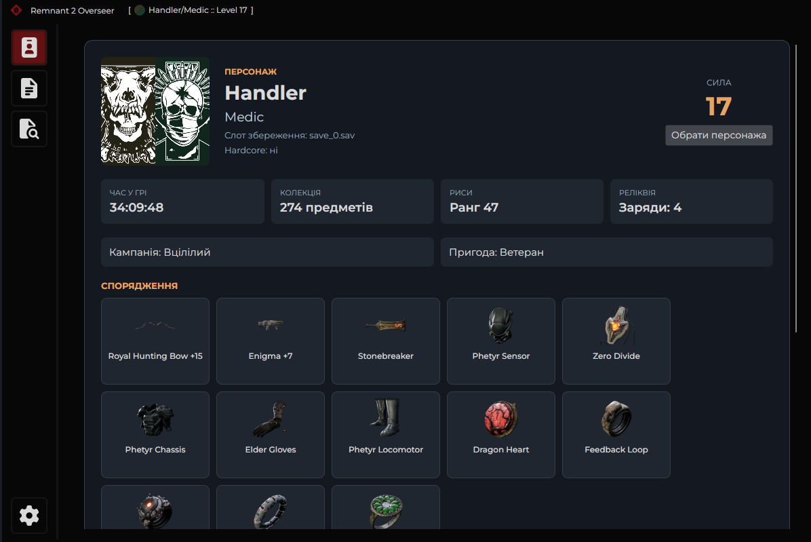
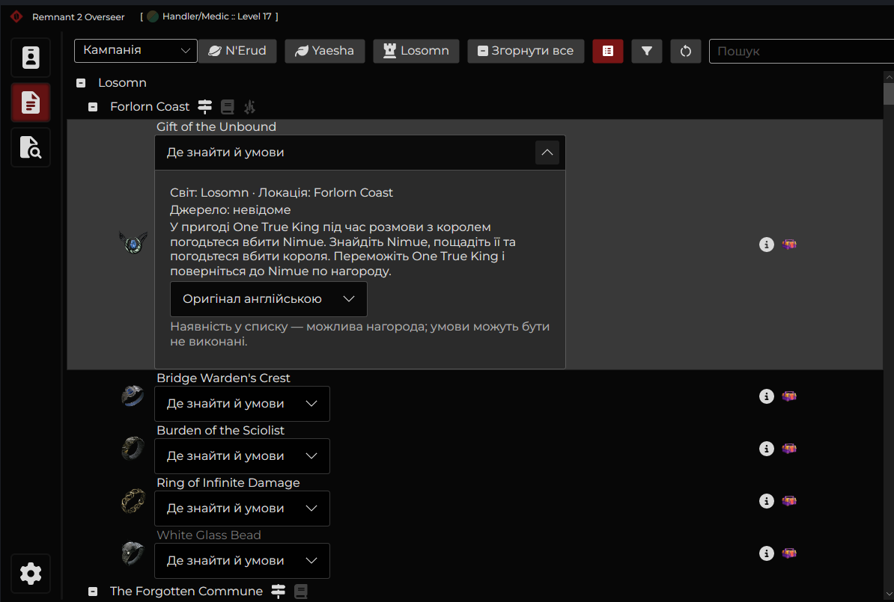
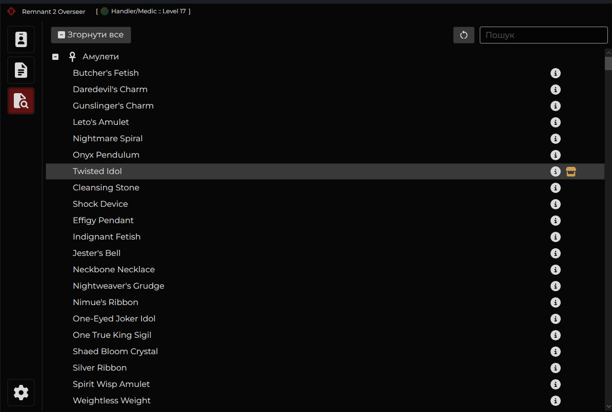

# Remnant 2 Overseer — український варіант

Експериментальний локальний переглядач збережень Remnant II для Linux і Windows. Показує персонажа, кампанію, пригоду, локації та можливі нагороди; інтерфейс частково українською. Основа — [Remnant Overseer](https://github.com/Angelore/remnant-two-overseer) та [lib.remnant2.analyzer](https://github.com/AndrewSav/lib.remnant2.analyzer).

## Стан і обмеження

Проєкт у розробці. Умови нагород не завжди підтверджені: перевірені переклади звірені з базою, решта машинні та можуть містити помилки. Boss Rush не аналізується. Windows і графічний інтерфейс ще потребують перевірки. Дані збережень читаються з тимчасових копій; оригінали гра не має змінюватися програмою.

Іконки предметів, отримані з вікі й локальних файлів гри, не включені в цей публічний репозиторій: права на їхнє перевидання не перевірені. За відсутності файлів показуються заглушки. За наявності власних файлів помістіть PNG з назвами стабільних ID (наприклад `Item_Flashlight.png`) у `encyclopedia/images/items/` перед складанням. Ліцензія коду не надає прав на ігрові зображення; успадковані ресурси в `RemnantOverseer/Assets` потребують окремої перевірки.

Докладна [інструкція українською](INSTRUCTIONS_UA.md): встановлення, запуск і вибір збережень.

## Знімки екрана

Профіль персонажа:



Перегляд кампанії та можливих нагород:



Перелік предметів:



## Складання

Потрібні .NET SDK 10 та доступ до NuGet під час першого складання:

```sh
dotnet build RemnantOverseer/RemnantOverseer.csproj -c Release
dotnet publish RemnantOverseer/RemnantOverseer.csproj -c Release -r linux-x64 --self-contained true -o publish/linux-x64
dotnet publish RemnantOverseer/RemnantOverseer.csproj -c Release -r win-x64 --self-contained true -o publish/win-x64
```

У налаштуваннях виберіть папку, що містить `profile.sav` та `save_N.sav`. Не публікуйте особисті збереження або журнали аналізу.

## Ліцензії та джерела

Вихідний Remnant Overseer — MIT, див. [LICENSE](LICENSE). База предметів `lib.remnant2.analyzer` — MIT, див. [LICENSE-ITEM-DB.txt](encyclopedia/LICENSE-ITEM-DB.txt). Каталог описів походить з [Remnant2-World-Analyzer](https://github.com/marcops/Remnant2-World-Analyzer) та бази аналізатора. Переклади частково машинні. Назви і торговельні марки Remnant II належать їхнім власникам; це неофіційний проєкт.
